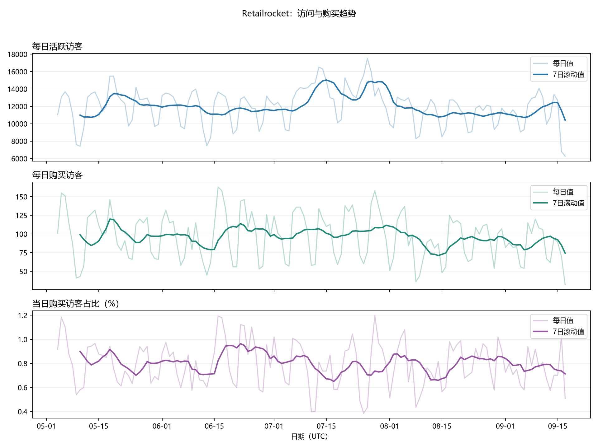

# Retailrocket 电商行为分析：MySQL + Python

使用真实匿名电商数据，完成MySQL导入、时间属性关联、指标汇总，再由Python连接数据库读取分析结果并生成7张图。分析重点是访问与购买、星期规律、有序漏斗、回访留存，以及商品属性覆盖。项目未实施线上业务改动或真实A/B实验。



## 主要发现

- UTC周末的购买访客占比低于工作日。7月11—12日、25—26日出现较高访问与较低购买占比并存的现象，不能仅凭这些图归因于渠道或机器人。
- 共同观察样本中，有序购买对数从24小时的14,535增加到7天的15,520，增幅约6.8%。
- 首次观察后的精确日回访率：D1约2.766%、D7约0.565%、D30约0.159%。首次观察不等于注册，未在指定日期回访不等于永久流失。
- 23.84%的行为事件没有匹配到历史类别；10.9%的购买事件可售状态未知。未知值保留，不倒填未来属性。

详细解释见 [中文分析报告](reports/analysis_report.md)。

## 数据来源与使用

[Retailrocket Kaggle原始数据](https://www.kaggle.com/datasets/retailrocket/ecommerce-dataset)：events.csv、category_tree.csv、item_properties_part1.csv、item_properties_part2.csv。原始数据许可为CC BY-NC-SA 4.0，使用数据和衍生成果须遵守来源许可及署名要求。原始CSV不包含在仓库中，也不向第三方软件或数据库发起上传。

样本行为时间为UTC 2015-05-03至2015-09-18；事件2,756,101行，访客标识1,407,580个，商品235,061个。商品属性两部分合计20,275,902行；类别树1,669行。类别名称、渠道和用户注册信息没有直接提供。

## 数据流程

```text
4份原始CSV → MySQL原始表
→ 商品属性生效区间 → 行为整合明细 events_enriched
→ 每日/星期/小时/留存/漏斗/类别/可售状态分析表
→ Python使用SQLAlchemy + PyMySQL读取汇总结果
→ pandas整理 + Matplotlib绘图
```

数据库负责主要关联和指标计算。Python在小型汇总结果上做对比、滚动指标和绘图，不重新读取原始CSV执行整套分析。

## 目录

|目录或文件|内容|
|---|---|
|sql/|01—20号数据库脚本|
|src/db_connect.py|数据库连接；密码在终端输入|
|src/test_mysql.py|连接及139天、事件总数核对|
|src/plot_*.py|6份绘图脚本，生成7张图|
|results/|Python从MySQL导出的汇总快照，不含用户级原始日志|
|figures/|7张图，可直接查看|
|reports/analysis_report.md|中文分析、口径与边界|
|requirements.txt|本次运行使用的直接依赖版本|
|requirements-lock.txt|Windows Python 3.13.9环境完整依赖记录|

## 运行：现有数据库已准备好

在VS Code打开项目目录，用Windows PowerShell运行：

```powershell
python -m venv .venv
.\.venv\Scripts\python.exe -m pip install -r requirements.txt
.\.venv\Scripts\python.exe src/test_mysql.py
.\.venv\Scripts\python.exe src/plot_daily.py
.\.venv\Scripts\python.exe src/plot_weekday.py
.\.venv\Scripts\python.exe src/plot_july.py
.\.venv\Scripts\python.exe src/plot_funnel.py
.\.venv\Scripts\python.exe src/plot_retention.py
.\.venv\Scripts\python.exe src/plot_products.py
```

本次验证环境为Python 3.13.9（Anaconda分发）。如系统python命令不可用，使用实际Python解释器完整路径创建虚拟环境。本机对应示例为 `& "D:\Users\admin\Anaconda33\python.exe" -m venv .venv`，其他电脑必须调整。

确认MySQL服务运行。连接参数在src/db_connect.py，默认为127.0.0.1:3306、retailrocket数据库及root账户；其他环境请改用对应账户。脚本只读取分析表，并写出本地CSV、PNG，不在Python中修改数据库。每次单独运行脚本都要在终端输入密码，密码不会显示或保存。中文字体优先Microsoft YaHei/SimHei；其他系统需安装适当中文字体或调整字体配置。

## 从空库复现SQL

1. 安装MySQL 8.0，下载原始CSV。查看 `SHOW VARIABLES LIKE 'secure_file_priv';` 并将文件放入获准的目录。
2. 修改02、07号SQL中的本机文件路径。按01—20顺序执行，每一步完成核对后继续。
3. 02导入行为；07导入类别和属性两个部分，预期属性总数20,275,902。07在整理交付包时补齐了第二部分，已存在完整数据的数据库不要重跑。
4. 大文件导入超过Workbench等待时间时，先检查后台进程与行数，不要重复导入。客户端断开不代表服务端已停止。此前本项目曾因重试导致重复导入，已清空属性原始表并按单次导入重新核对完成。
5. CREATE TABLE和ADD INDEX脚本主要用于首次构建，不是幂等重跑流程。不要对已完成的项目整批重新执行，LOAD DATA会追加记录。
6. 20号为六项逻辑检查，预期failure_count全为0。验收只覆盖所列检查，不代表所有数据问题已排除。

## 图表索引

|脚本|输出|主要问题|
|---|---|---|
|plot_daily.py|01_daily_trends.png|每日访问与购买变化|
|plot_weekday.py|02_weekday_pattern.png|UTC星期规律|
|plot_july.py|03_july_comparison.png|7月周末与小时分布|
|plot_funnel.py|04_funnel_comparison.png|24小时有序漏斗、共同样本窗口比较|
|plot_retention.py|05_retention.png|精确日回访、周分群回访|
|plot_products.py|06_product_categories.png、07_availability.png|类别分布、历史属性覆盖及状态构成|

## 统计口径

- 所有时间均按UTC。业务时区未知；不能把UTC星期直接解释为访客当地星期。
- 趋势、星期和小时分析排除首尾不完整日，保留137天；这不保证中间每天采集完全。
- 当日购买占比=当日去重购买访客/当日去重活跃访客。跨日加权使用访客日，不能称为全期独立访客购买率。
- 有序漏斗要求同访客、同商品、首次浏览<首次后续加购<后续购买，且购买在首次浏览起指定窗口内。统计单位是访客—商品对。相同时间戳不推断顺序，未经过加购的其他购买路径不属于此漏斗。
- 24小时主漏斗要求至少24小时观察期；窗口对比统一要求7天，因此两张子图样本不同。两组结果不能直接相减。
- D1/D7/D30是精确第N个自然日回访，分母筛选足够观察期。周留存是用户年龄第7—13天等龄段，不是精确D7；不成熟格子为空，第0周含首次事件为100%。首个不完整入群周不展示在热图中。
- 属性按[生效开始, 下一次变化)匹配。首次记录前为未知；最后值暂时延续，没有使用未来属性倒填。未知状态不等于不可售。
- 原始事件不自动去重；先前对全量原文件的检查发现460条额外完全重复事件，购买事件中未发现五字段完全重复。本轮核心转化/留存以去重访客或访客—商品对为单位；事件量图保留原始记录，尚未做全面删重敏感性分析。

## 发布前

只提交src、sql、figures、results、reports、README和依赖文件。不要上传.venv、原始CSV、账户密码或环境私密配置。本包尚未创建或推送远程仓库。图表和报告是公开数据上的探索性分析，不声称为企业实现营收提升。
