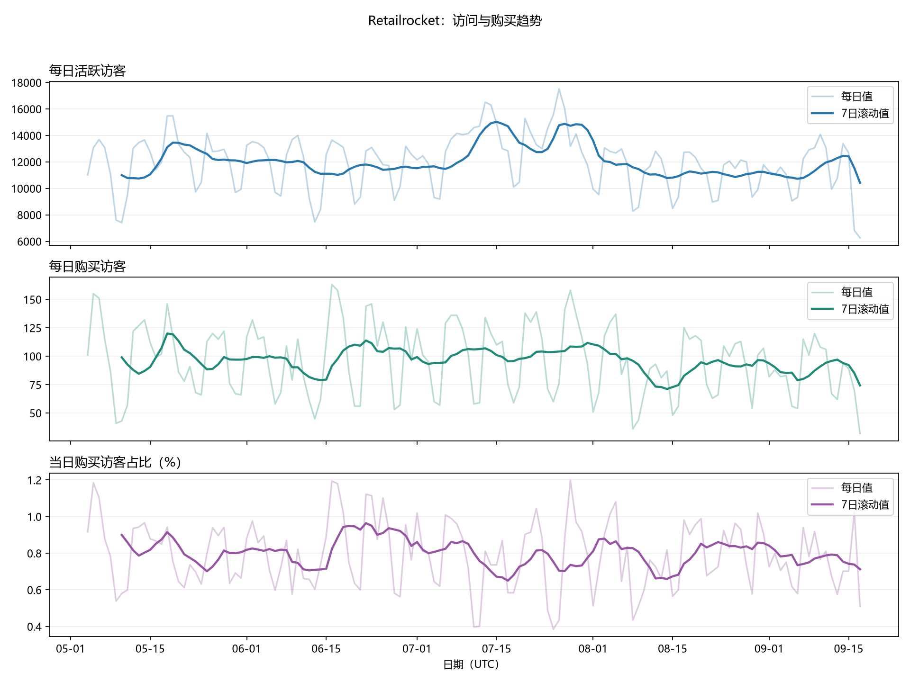
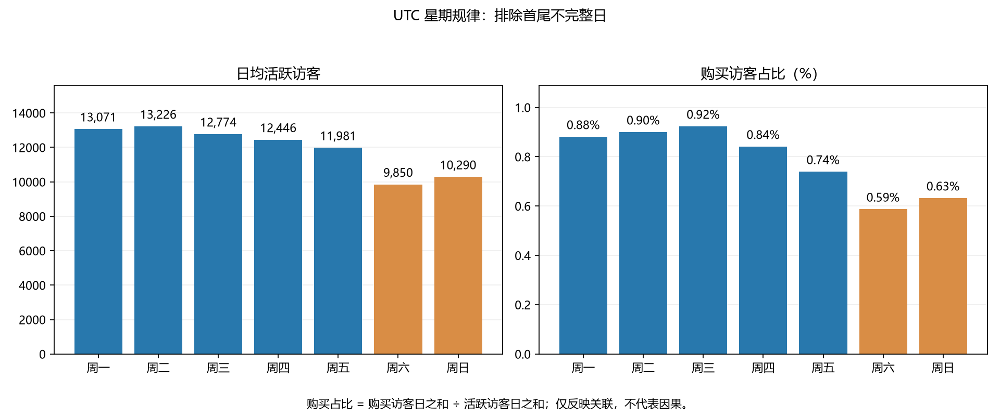
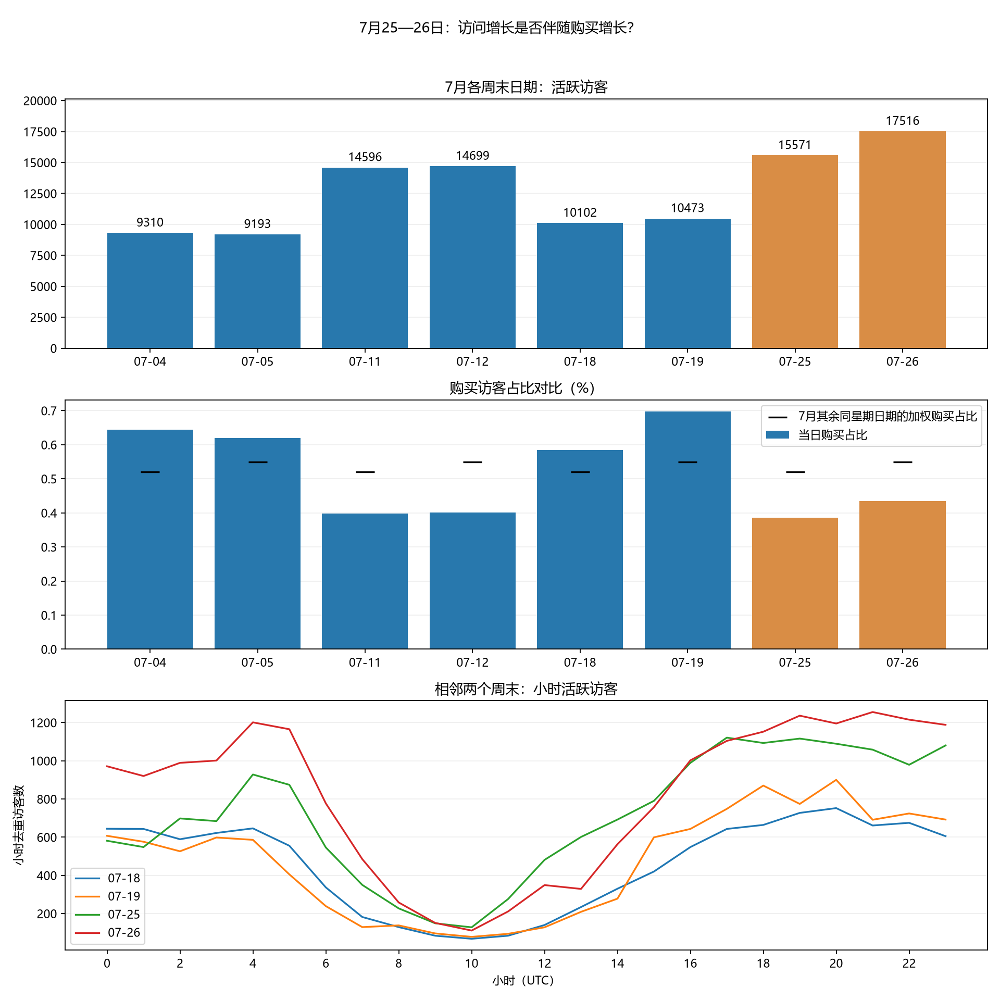
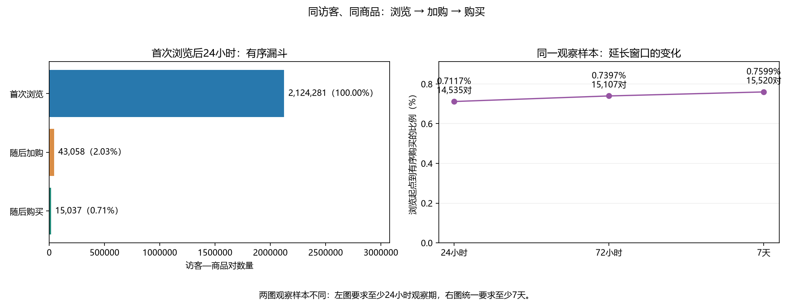
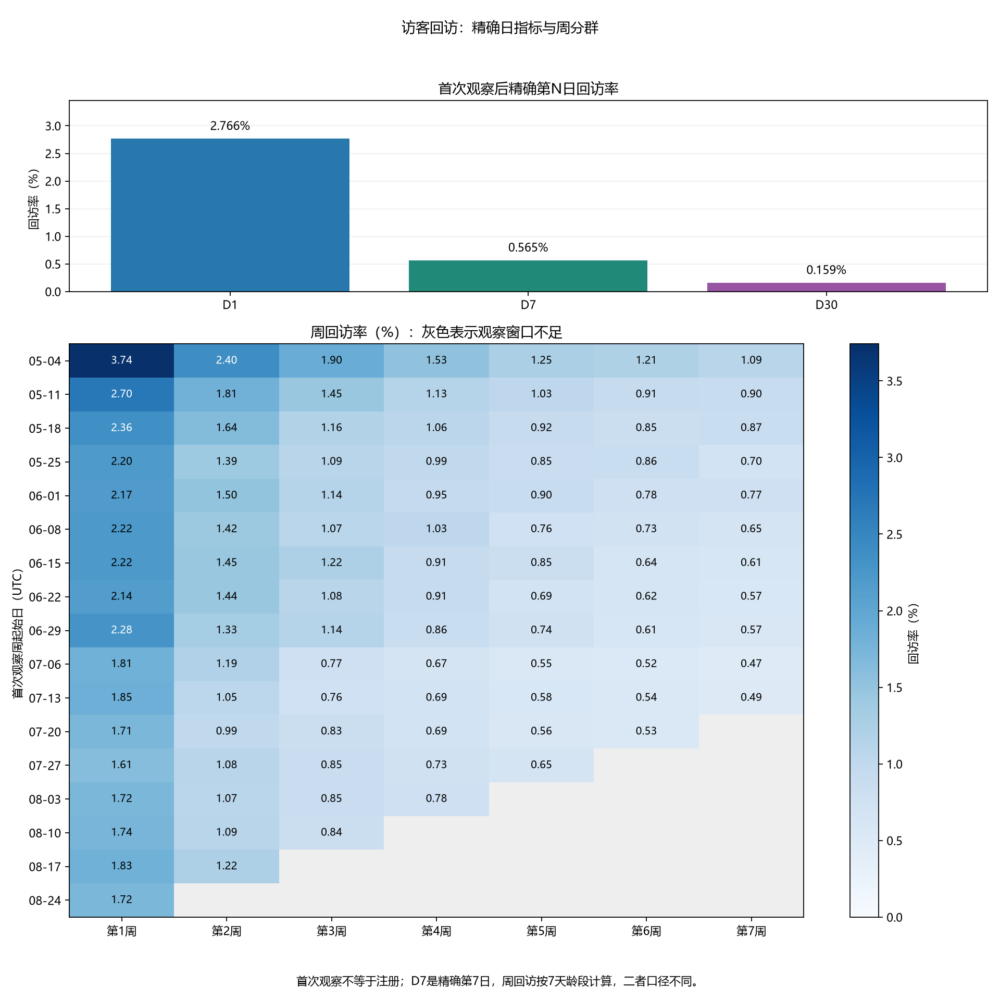
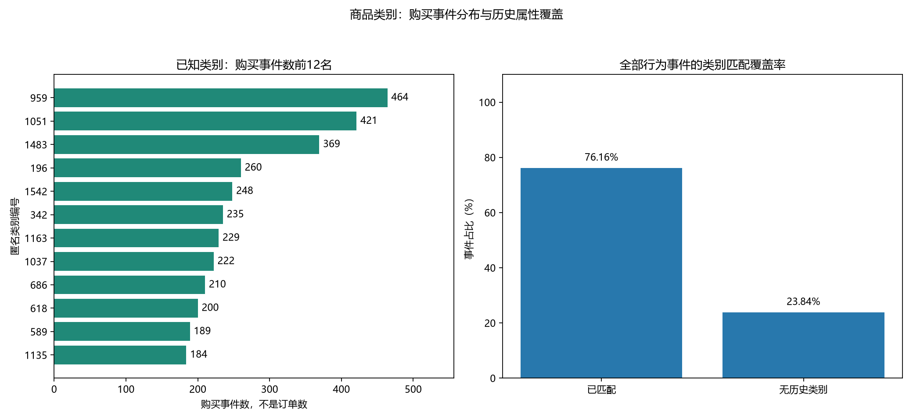
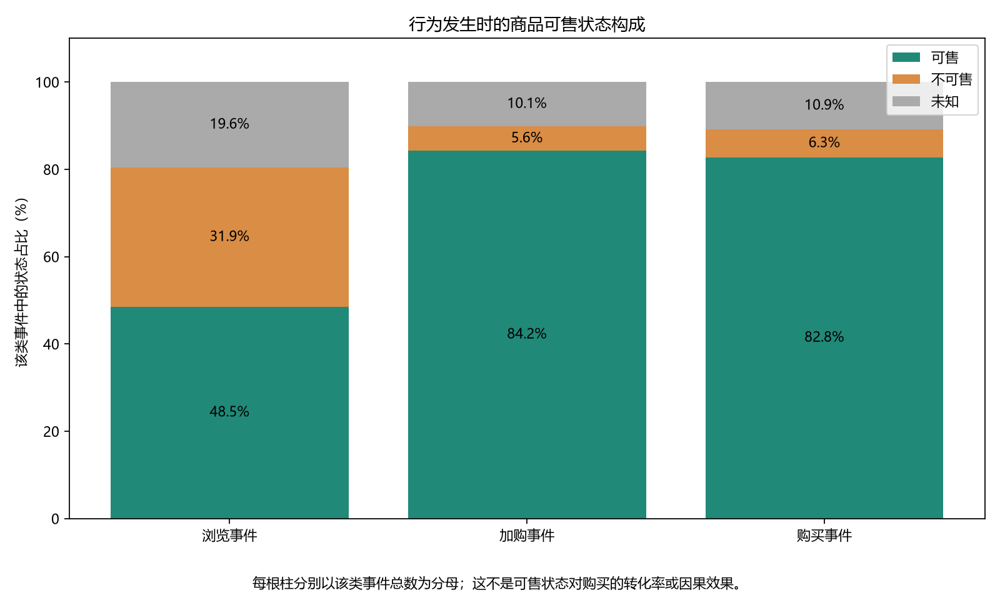

# Retailrocket 电商行为分析报告

## 分析目标与数据处理

分析公开电商行为中的访问、购买、回访及属性覆盖，识别值得继续验证的问题。数据为2015年历史匿名样本，不用于判断今天的业务表现。四份CSV进入MySQL后，先建立属性生效区间，再左连接到行为事件，保留未知记录；整合前后均为2,756,101行，没有因关联导致记录数膨胀。六项最终逻辑检查在Workbench中的运行结果均为0；Python读取并绘图，保留查询结果快照。

## 1. 访问增长没有同步体现为更高购买占比

UTC工作日日均活跃访客约12,707，购买访客日占比约0.860%；周末分别约10,070与0.610%。该差异是描述性关联，不是星期的因果效果。

7月26日活跃访客为17,516、购买访客76，购买占比约0.434%；7月25日活跃访客15,571、购买访客60，占比约0.385%。两天均低于其他7月同星期日期的加权基准，7月11—12日也有类似现象。与前一周末对比的小时图显示访问增量分布在多个小时，不是明显的单小时孤立峰值；这不足以排除自动流量或采集问题。

建议下一步验证访客首次观察/回访结构、行为频次和商品结构，而不是直接下结论称低质量渠道或机器人导致下降。

## 2. 延迟购买只能解释部分漏斗差异

24小时主漏斗：首次浏览2,124,281对，随后加购43,058对，随后购买15,037对；加购到购买约34.92%。这不是全站订单漏斗，而是同访客同商品样本内首次浏览启动的有序路径。

共同7天观察样本的起点为2,042,310对：

|窗口|加购对数|购买对数|浏览到购买比例|
|---|---:|---:|---:|
|24小时|41,574|14,535|0.7117%|
|72小时|42,501|15,107|0.7397%|
|7天|43,147|15,520|0.7599%|

窗口延长后增加985对购买，约6.8%的相对增幅，整体转化率增加约0.0482个百分点。该结果没有说明加购后放弃的原因，也不证明7天后不会购买。不同窗口中的加购分母随窗口变化，不能把全部差额视作固定加购群体的实验效果。

## 3. 首次观察后的回访率较低，较晚分群值得关注

|指标|具备观察期的访客|回访访客|回访率|
|---|---:|---:|---:|
|D1|1,401,695|38,775|2.7663%|
|D7|1,346,473|7,607|0.5650%|
|D30|1,131,714|1,795|0.1586%|

周留存热图中，7月后分群的第1周回访率普遍低于5—6月。首次观察不是注册，访客标识可能不能稳定对应现实中的同一人；数据起点左截断、访客结构及采集变化均可能影响结果。因此不把这些比例直接评判为产品留存好坏，也不将未按指定日期回访的访客定义为永久流失。

## 4. 属性缺失必须纳入业务解释

23.84%的行为事件没有可匹配的历史类别，无法按已知类别解释所有行为。已知类别编号959购买事件464条、1051为421条、1483为369条；编号匿名，不能推断具体商品名称，事件数也不等于订单数或营收。

|事件类型|最后已知可售|最后已知不可售|未知状态|
|---|---:|---:|---:|
|浏览|48.5%|31.9%|19.6%|
|加购|84.2%|5.6%|10.1%|
|购买|82.8%|6.3%|10.9%|

约6.3%的购买事件（1,423条）匹配到最后已知不可售状态，可能涉及属性时点滞后、字段定义或其他数据问题，尚不能解释为缺货购买。列间分母不同，这张图不是可售状态的转化效果比较。优先验证属性含义和更新时间，再讨论库存或展示优化。

## 后续验证方案

1. 对7月高访问低购买日期做访客结构、行为强度分层，并与同星期对照；检查结论是否被少数高频访客驱动。
2. 对属性匹配增加距最近更新时间的分层，量化旧属性占比，并复核不可售购买事件的时间路径。
3. 对首尾日期、异常流量、完全重复记录和漏斗窗口做更完整的敏感性分析。
4. 若要评估商品展示或加购流程改动，应另外设计随机分流实验，预先定义单位、主指标、护栏、最小可检测效应和样本量。本数据没有实验分组，本项目没有真实A/B测试结果。

## 复现与证据边界

运行步骤、数据许可和完整口径见README。当前CSV和图片为本机已运行结果，本次整理核对Python语法与汇总一致性，并补齐SQL中缺失的属性第二部分导入记录；没有从空库重新执行整个SQL流程，也没有将本机私密凭据写入代码。
